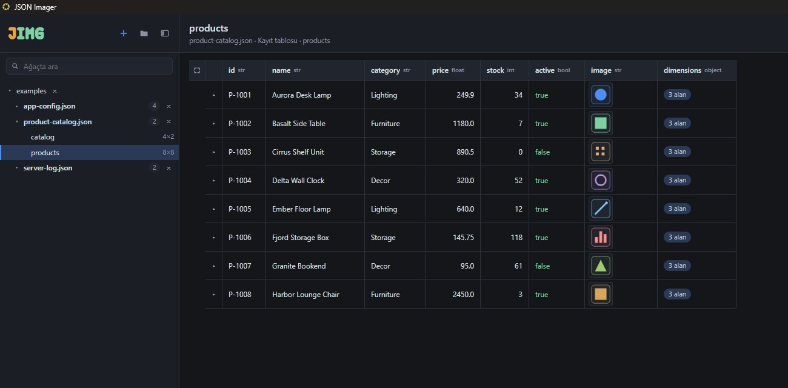
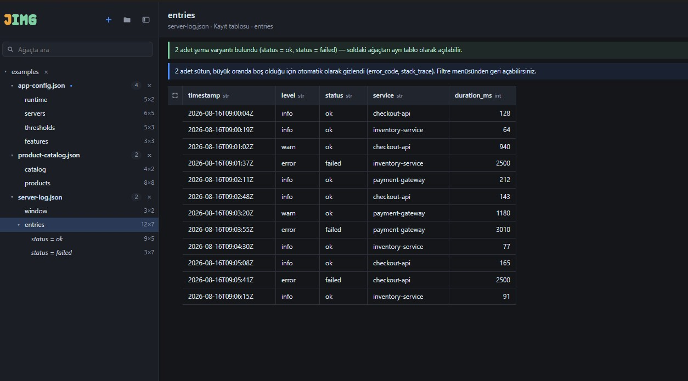
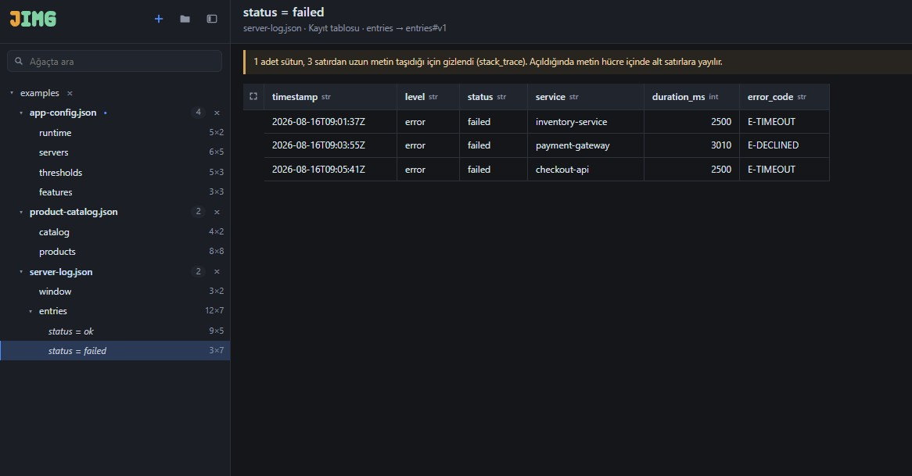
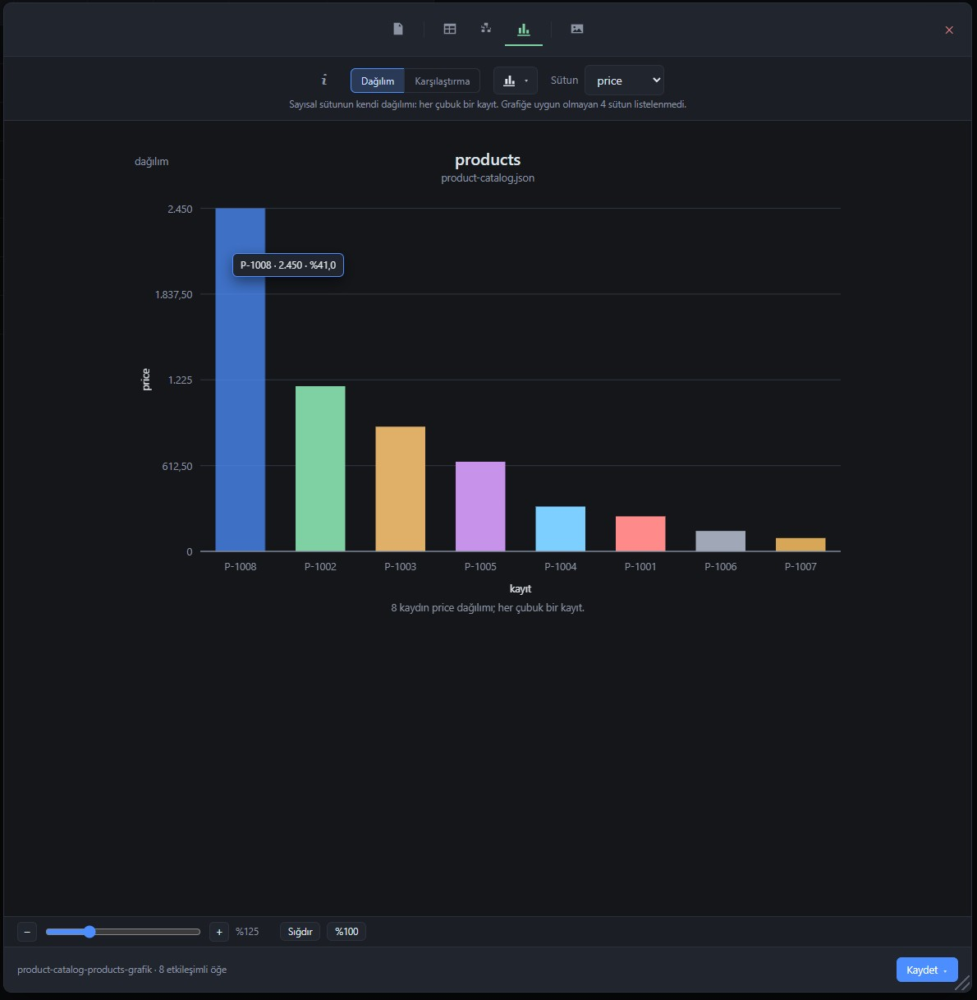
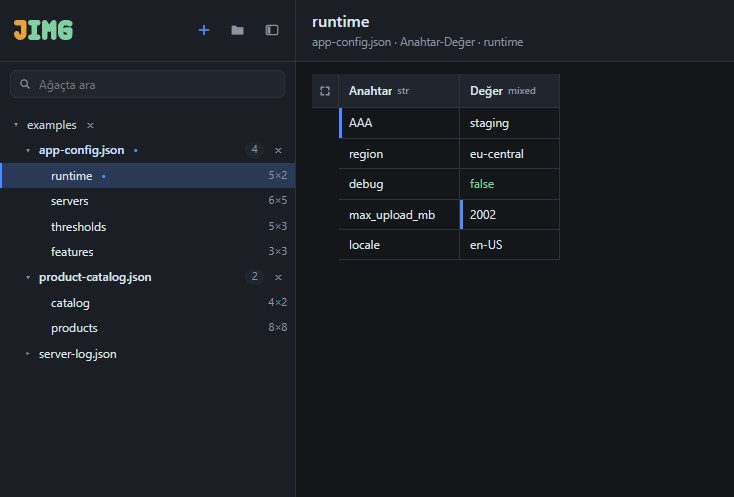
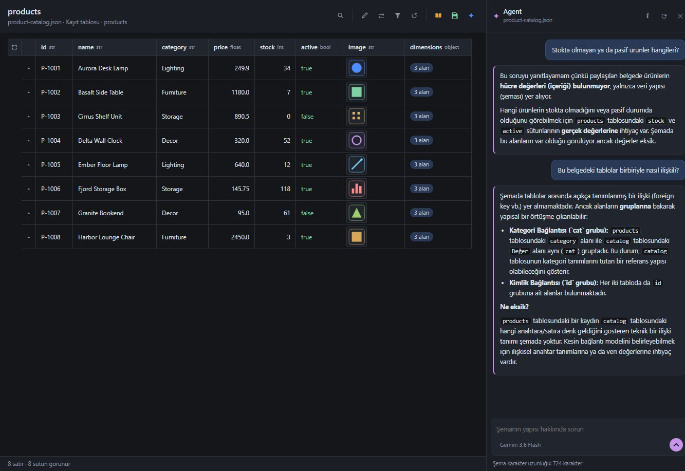

# JSON Imager

**English** · [Türkçe](README.tr.md)

JSON Imager is a Windows desktop tool that opens JSON documents, finds the tables inside them and
turns those tables into readable text, images and charts. It runs entirely on your computer: no
account, no server, no telemetry.



## Features

- **Finds the tables for you.** Lists of records, objects keyed by id, key–value settings,
  side-by-side objects and keys holding lists are each recognised and shown as a table. Every
  table in a document appears in the tree on the left.
- **Explains odd data.** Records that carry different sets of fields are split into schema
  variants you can open separately. Mostly empty columns and columns of long text are hidden, and
  a notice says which ones and why; the filter menu shows them again.
- **Arrange the table.** Sort, filter, reorder, resize and hide columns, expand nested values,
  or transpose a narrow table so it reads top to bottom.
- **Search one column or all.** Plain text searches every visible column; `@column:value`
  searches one column and `@column=value` matches exactly. Matches are highlighted, and
  exports contain only what the search left on screen. Right-click a cell to copy its full
  value (or select it and press Ctrl+C) or to filter the table by it.
- **Export what you see.** Text as a report, outline, Markdown, CSV or HTML; the table, the schema
  tree or a chart as PNG, SVG or PDF; the schema tree as an editable draw.io file. The output
  follows the screen: same columns, same order, same rows.
- **Charts from questions.** The chart tab suggests the questions the table can answer, such as
  a distribution or a comparison, before you pick columns by hand.
- **Images inside documents.** Embedded images and image paths are shown in the table and in a
  gallery, and can be saved with their original bytes.
- **Edit and save.** Change a value, a key, a column name or a table name. Saving rewrites only
  what changed and keeps the rest of the file byte for byte.
- **Agent (optional).** Ask questions about a document. By default only the schema is sent;
  sending the values of the table on screen is a setting you turn on.
- **Turkish and English, dark and light theme,** three table densities, adjustable font size.

## Screenshots

| | |
|---|---|
|  |  |
| **Schema variants** — rows with different fields become separate tables | **Long text** — hidden with a notice, shown again on demand |
|  |  |
| **Charts** — suggested from the table's own columns | **Editing** — unsaved changes marked in the table and the tree |

The screenshots show the Turkish interface.

## Download and run

1. Download `JSON Imager.exe` from the **Releases** page of this repository. There is no
   installer; the executable runs from any folder.
2. Windows may show a SmartScreen warning because the executable is not code-signed. Choose
   **More info → Run anyway** if you trust the download.
3. To check that the file is exactly the one published, compare its fingerprint with the SHA-256
   value in the release notes:

   ```powershell
   Get-FileHash ".\JSON Imager.exe" -Algorithm SHA256
   ```

**Requirements:** 64-bit Windows with the Microsoft Edge WebView2 Runtime, which is part of
Windows 11. Developed and tested on Windows 11.

On first start the application opens three example documents. Settings, stored keys and the
examples live in `%APPDATA%\JSON Imager\`; nothing is written next to the executable.

## Privacy

The tool reaches the network only in two cases, and both are your choice:

- **When you send a question to the Agent.** The selected provider receives the schema of the
  document — dataset kinds, field names, types and fill ratios. Cell values, file paths and images
  are not sent. If you turn on **Data sharing**, the visible rows of the table on screen are sent
  as well (up to 100 rows, without images), and the Agent panel shows that it is on. The Agent
  can be turned off completely in Settings.
- **When you enable image addresses in Settings.** Images given as web addresses are then
  downloaded over HTTPS. The setting is off by default.

Opening, arranging, exporting and editing never use the network. API keys are stored encrypted
with Windows DPAPI. A document is written only when you save it, and only to the file it came
from. The full list of boundaries and how each is checked is in [SECURITY.md](SECURITY.md).

## Agent

The Agent answers questions about a document's structure: what the tables are, what looks
unusual, whether field names are consistent, how the data could be modelled. Questions about
the data itself — which products are out of stock, for example — need **Data sharing** turned
on in Settings; until then the Agent says so instead of guessing.



Choose a provider and model in Settings:

| Provider | What you need |
|---|---|
| Claude Code CLI | Claude Code installed and signed in on this computer; no key is stored |
| Gemini · Groq · Anthropic · OpenAI | An API key from that provider |
| Custom | The address of any OpenAI-compatible service, such as a local model server; a key is optional |

Each provider's note in Settings says how it uses what it receives. A custom address must use
https, or plain http to this computer only.

## Building from source

The project uses Python 3.14 on Windows.

```powershell
python -m venv .venv
.\.venv\Scripts\python.exe -m pip install -r requirements.txt
.\.venv\Scripts\python.exe run.py
```

Verification and the single-file build:

```powershell
.\.venv\Scripts\python.exe tools\check.py -q
.\.venv\Scripts\python.exe -m PyInstaller build.spec --noconfirm --clean
```

`tools\check.py` runs every check in the project, including the security boundaries.
`tools\devserver.py` serves the interface in a browser at `http://localhost:8765` for quick
work on the interface. How the code is organised is described in
[docs/ARCHITECTURE.md](docs/ARCHITECTURE.md).

## Reporting issues

Bugs and ideas are welcome as issues. **Security vulnerabilities** should be reported privately;
see [SECURITY.md](SECURITY.md).

## License

JSON Imager is released under the [MIT License](LICENSE). The executable bundles third-party
components; their licenses are reproduced in [THIRD-PARTY-NOTICES.md](THIRD-PARTY-NOTICES.md).
