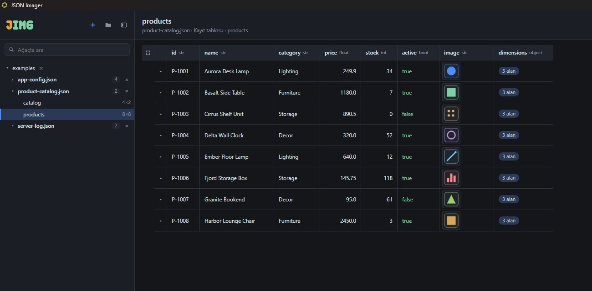
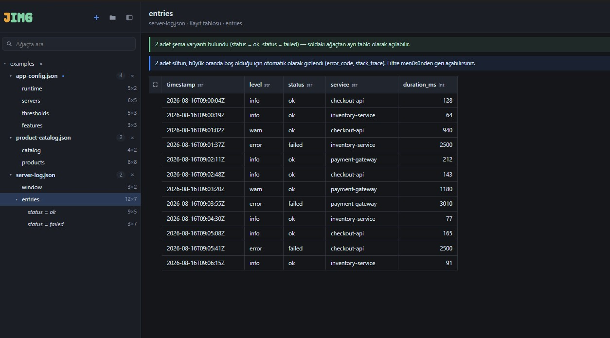
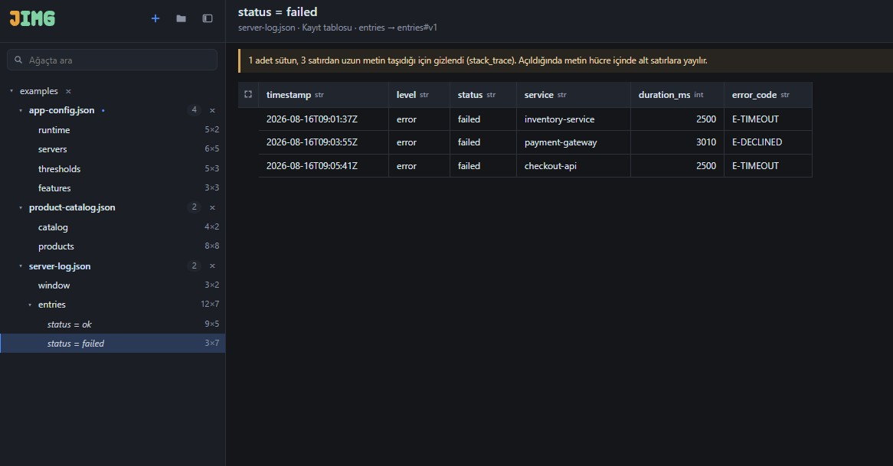
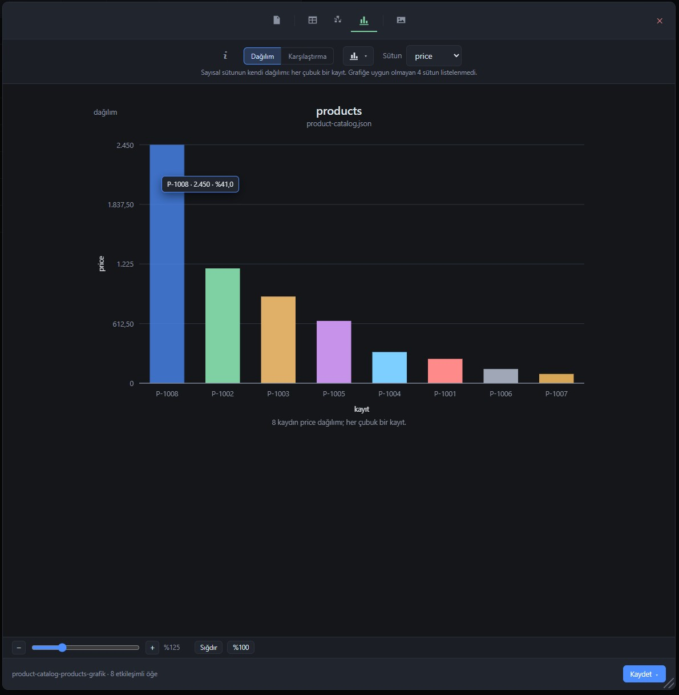
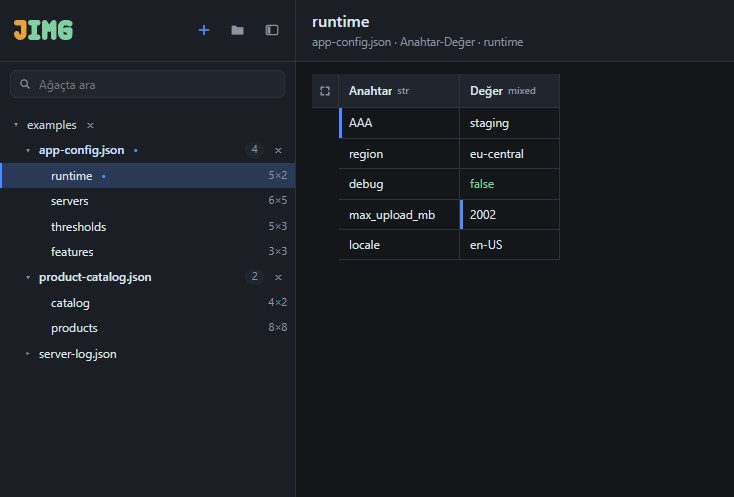
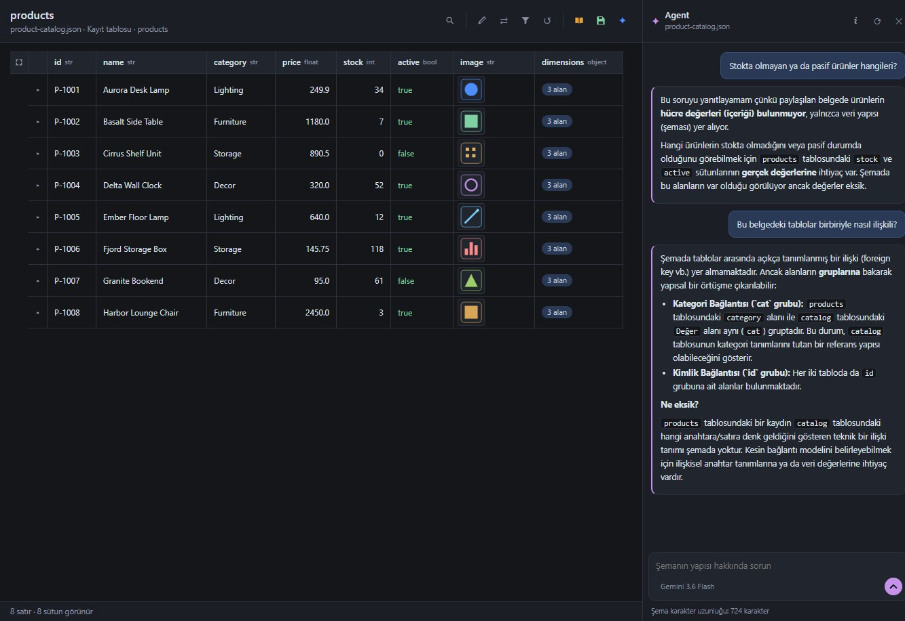

# JSON Imager

[English](README.md) · **Türkçe**

JSON Imager, JSON belgelerini açan, içlerindeki tabloları bulan ve bu tabloları okunur metne,
görsele ve grafiğe dönüştüren bir Windows masaüstü aracıdır. Tamamen bilgisayarınızda çalışır:
hesap yok, sunucu yok, telemetri yok.



## Özellikler

- **Tabloları kendisi bulur.** Kayıt listeleri, kimliğe göre anahtarlanmış nesneler, anahtar–değer
  ayarları, yan yana duran nesneler ve liste tutan anahtarlar ayrı ayrı tanınır ve tablo olarak
  gösterilir. Belgedeki her tablo soldaki ağaçta yer alır.
- **Tuhaf veriyi açıklar.** Farklı alan kümeleri taşıyan kayıtlar, ayrı açılabilen şema
  varyantlarına bölünür. Büyük ölçüde boş sütunlar ve uzun metin sütunları gizlenir; bir uyarı
  hangilerinin neden gizlendiğini söyler, filtre menüsü onları yeniden gösterir.
- **Tabloyu dilediğiniz gibi dizin.** Sütunları sıralayın, süzün, yeniden dizin, genişletin ve gizleyin; iç
  içe değerleri açın ya da dar bir tabloyu yukarıdan aşağı okunacak biçimde çevirin.
- **Tek sütunda ya da hepsinde arayın.** Düz metin görünen bütün sütunlarda arar;
  `@sütun:değer` tek sütunda arar, `@sütun=değer` birebir eşleşir. Eşleşmeler vurgulanır,
  dışa aktarma yalnızca aramanın ekranda bıraktığını içerir. Bir hücreye sağ tıklayarak
  değerinin tamamını kopyalayın (ya da seçip Ctrl+C'ye basın) veya tabloyu o değere göre süzün.
- **Gördüğünüzü dışa aktarın.** Metni rapor, ana hat, Markdown, CSV ya da HTML olarak; tabloyu,
  şema ağacını ya da bir grafiği PNG, SVG ya da PDF olarak; şema ağacını düzenlenebilir bir
  draw.io dosyası olarak. Çıktı ekranı izler: aynı sütunlar, aynı sıra, aynı satırlar.
- **Sorulardan grafik.** Grafik sekmesi, sütunları elle seçmeden önce tablonun yanıtlayabileceği
  soruları önerir: bir dağılım ya da bir karşılaştırma gibi.
- **Belgedeki görseller.** Gömülü görseller ve görsel yolları tabloda ve bir galeride gösterilir;
  özgün baytlarıyla kaydedilebilir.
- **Düzenleyin ve kaydedin.** Bir değeri, anahtarı, sütun adını ya da tablo adını değiştirin.
  Kaydetme yalnızca değişeni yeniden yazar; dosyanın geri kalanı bayt bayt aynı kalır.
- **Agent (isteğe bağlı).** Belge hakkında soru sorun. Varsayılan olarak yalnızca şema
  gönderilir; ekrandaki tablonun değerlerini göndermek sizin açtığınız bir ayardır.
- **Türkçe ve İngilizce, koyu ve açık tema,** üç tablo sıklığı, ayarlanabilir yazı boyutu.

## Ekran görüntüleri

| | |
|---|---|
|  |  |
| **Şema varyantları** — farklı alanlı satırlar ayrı tablolara ayrılır | **Uzun metin** — uyarıyla gizlenir, istenince yeniden görünür |
|  |  |
| **Grafikler** — tablonun kendi sütunlarından önerilir | **Düzenleme** — kaydedilmemiş değişiklik tabloda ve ağaçta işaretli |

## İndirme ve çalıştırma

1. `JSON Imager.exe` dosyasını bu deponun **Releases** sayfasından indirin. Kurulum yoktur;
   dosya herhangi bir klasörden çalışır.
2. Dosya kod imzalı olmadığı için Windows bir SmartScreen uyarısı gösterebilir. İndirdiğiniz
   dosyaya güveniyorsanız **Ek bilgi → Yine de çalıştır**'ı seçin.
3. Dosyanın yayımlananın ta kendisi olduğunu doğrulamak için parmak izini sürüm notundaki
   SHA-256 değeriyle karşılaştırın:

   ```powershell
   Get-FileHash ".\JSON Imager.exe" -Algorithm SHA256
   ```

**Gereksinimler:** Microsoft Edge WebView2 çalışma zamanı bulunan 64 bit Windows; Windows 11'de
hazır gelir. Windows 11'de geliştirildi ve sınandı.

İlk açılışta uygulama üç örnek belge açar. Ayarlar, saklanan anahtarlar ve örnekler
`%APPDATA%\JSON Imager\` altında durur; dosyanın yanına hiçbir şey yazılmaz.

## Gizlilik

Araç ağa yalnızca iki durumda çıkar ve ikisi de sizin seçiminizdir:

- **Agent'a bir soru gönderdiğinizde.** Seçili sağlayıcı belgenin şemasını alır: veri kümesi
  türleri, alan adları, tipler ve doluluk oranları. Hücre değerleri, dosya yolları ve görseller
  gönderilmez. **Veri gönderimi**ni açarsanız ekrandaki tablonun görünen satırları da gider
  (en fazla 100 satır, görselsiz) ve Agent paneli bunun açık olduğunu gösterir. Agent,
  Ayarlar'dan tamamen kapatılabilir.
- **Ayarlar'da görsel adreslerini açtığınızda.** Web adresiyle verilen görseller o zaman HTTPS
  üzerinden indirilir. Ayar varsayılan olarak kapalıdır.

Belge açma, tabloyu dizme, dışa aktarma ve belgeyi değiştirme hiçbir zaman ağı kullanmaz. API anahtarları
Windows DPAPI ile şifrelenmiş olarak saklanır. Bir belge yalnızca siz kaydettiğinizde ve yalnızca
geldiği dosyaya yazılır. Sınırların tam listesi ve her birinin nasıl denetlendiği
[SECURITY.md](SECURITY.md) belgesindedir (İngilizce).

## Agent

Agent belgenin yapısıyla ilgili soruları yanıtlar: tabloların ne olduğu, neyin tuhaf göründüğü,
alan adlarının tutarlı olup olmadığı, verinin nasıl modellenebileceği. Verinin kendisiyle ilgili
sorular — örneğin hangi ürünlerin stokta olmadığı — Ayarlar'da **Veri gönderimi**nin açık
olmasını gerektirir; o zamana kadar Agent tahmin yürütmek yerine bunu söyler.



Sağlayıcıyı ve modeli Ayarlar'dan seçin:

| Sağlayıcı | Gereken |
|---|---|
| Claude Code CLI | Bu bilgisayarda kurulu ve oturum açılmış Claude Code; anahtar saklanmaz |
| Gemini · Groq · Anthropic · OpenAI | O sağlayıcıdan bir API anahtarı |
| Özel | OpenAI uyumlu herhangi bir hizmetin adresi, örneğin yerel bir model sunucusu; anahtar isteğe bağlı |

Ayarlar'daki her sağlayıcı notu, gönderilenin nasıl kullanıldığını söyler. Özel adres https
olmalı ya da yalnızca bu bilgisayara düz http olmalı.

## Kaynaktan derleme

Proje Windows'ta Python 3.14 kullanır.

```powershell
python -m venv .venv
.\.venv\Scripts\python.exe -m pip install -r requirements.txt
.\.venv\Scripts\python.exe run.py
```

Doğrulama ve tek dosyalık derleme:

```powershell
.\.venv\Scripts\python.exe tools\check.py -q
.\.venv\Scripts\python.exe -m PyInstaller build.spec --noconfirm --clean
```

`tools\check.py` güvenlik sınırları dahil projedeki tüm denetimleri koşar. `tools\devserver.py`
arayüz üzerinde hızlı çalışmak için arayüzü tarayıcıda `http://localhost:8765` adresinde sunar.
Kodun nasıl düzenlendiği [docs/ARCHITECTURE.md](docs/ARCHITECTURE.md) belgesinde anlatılır
(İngilizce).

## Sorun bildirme

Hatalar ve fikirler issue olarak memnuniyetle karşılanır. **Güvenlik açıkları** gizli olarak
bildirilmelidir; bkz. [SECURITY.md](SECURITY.md).

## Lisans

JSON Imager [MIT Lisansı](LICENSE) ile yayımlanır. Çalıştırılabilir dosya üçüncü taraf
bileşenler içerir; lisansları [THIRD-PARTY-NOTICES.md](THIRD-PARTY-NOTICES.md) belgesinde yer
alır.
